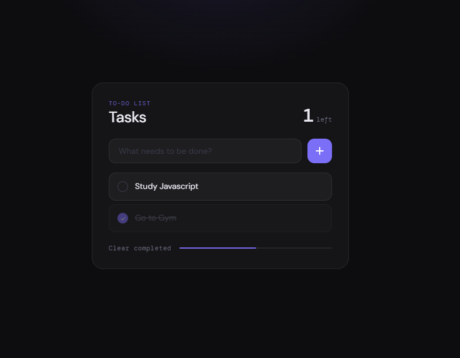

<div align="center">

# ✦ My To-do List

### A simple, modern way to organize your day.

Manage your tasks, track your progress, and stay productive with a clean dark-themed interface.

<br>

[](https://vinn-devv.github.io/My-To-do-List/)
[](https://developer.mozilla.org/en-US/docs/Web/HTML)
[](https://developer.mozilla.org/en-US/docs/Web/CSS)
[](https://developer.mozilla.org/en-US/docs/Web/JavaScript)

</div>

---

## ✨ Features

| Feature | Description |
|:---:|---|
| 📝 | **Add Tasks** — Quickly add tasks to your list. |
| ✅ | **Complete Tasks** — Mark tasks as completed. |
| 🗑️ | **Delete Tasks** — Remove individual tasks. |
| 📊 | **Progress Tracking** — Monitor your task completion progress. |
| 🧹 | **Clear Completed** — Remove completed tasks in one action. |
| 💾 | **Local Storage** — Keep your tasks saved in your browser. |
| 🌙 | **Dark UI** — Enjoy a clean, modern interface. |
| 📱 | **Responsive Design** — Use the app on different screen sizes. |

---

## 🖥️ Preview

<div align="center">

**A focused workspace for your daily tasks.**

<!-- Add a screenshot of your app here -->
<!-- Save it in the repository as: screenshot.png -->



</div>

---

## 🛠️ Built With

<div align="center">

| HTML5 | CSS3 | JavaScript | Local Storage |
|:---:|:---:|:---:|:---:|
| Structure | Styling | Functionality | Data persistence |

</div>

---

## 🚀 Getting Started

### Run Locally

**1. Clone the repository**

```bash
git clone https://github.com/vinn-devv/My-To-do-List.git
```

**2. Navigate to the project folder**

```bash
cd My-To-do-List
```

**3. Open `index.html`**

Open the file in your browser to start using the app.

---

## 📂 Project Structure

```text
My-To-do-List/
├── index.html    # App structure
├── style.css     # Visual design
├── script.js     # App functionality
└── README.md     # Project documentation
```

---

## 📚 What I Learned

- DOM manipulation and event handling
- JavaScript arrays, objects, and functions
- Managing task state
- Browser Local Storage
- Responsive layouts and CSS styling
- Deploying a static website with GitHub Pages

---

## 🌐 Live Website

<div align="center">

### Ready to organize your tasks?

[**→ Open My To-do List**](https://vinn-devv.github.io/My-To-do-List/)

</div>

---

<div align="center">

Made by **[vinn-devv](https://github.com/vinn-devv)**

<sub>Learning, building, and improving one project at a time.</sub>

</div>
